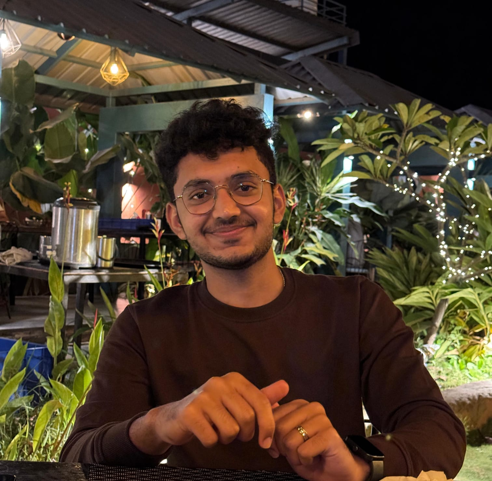

<!-- ======================= HERO-01 ======================= -->

<h1 align="center">
  Hey 👋, I'm Adarsh
</h1>

<p align="center">
  <b>Developer • Builder • Learner</b>
</p>

<p align="center">
  
</p>

<p align="center">
  
</p>

<p align="center">
  I enjoy building things, breaking them, and figuring out why they broke.
</p>

<p align="center">
  <a href="https://github.com/Adarsh812793">
    
  </a>
  <a href="https://www.linkedin.com/in/adarsh-ladwa-b6b28a330/">
    
  </a>
  <a href="adarshladwa07@gmail.com">
    
  </a>
</p>

<br>

---

<!-- ======================= CURRENTLY-02 ======================= -->

## 🧭 Currently

<table>
<tr>
<td width="50%">

### 🔨 Building

Web applications and backend projects.

</td>

<td width="50%">

### 📚 Learning

Backend development with Node.js, Express & MongoDB.

</td>
</tr>

<tr>
<td width="50%">

### 🧠 Exploring

REST APIs, authentication, databases & backend architecture.

</td>

<td width="50%">

### 🎯 Goal

Become a stronger full-stack developer by building real projects.

</td>
</tr>
</table>

---

<!-- ======================= ABOUT-03 ======================= -->

## 👨‍💻 About Me

I'm a student and developer who enjoys understanding how things work
behind the scenes and turning that understanding into working projects.

I started with web development and I'm currently diving deeper into
backend development, databases, APIs and authentication.

I learn best by **building things, breaking them, debugging them,
and eventually figuring out why they broke.** 😄

---

<!-- ======================= TECH STACK-04 =======================-->

## 🛠️ Tech Stack

### 💻 Languages

<p align="left">
  
</p>

### ⚙️ Backend & Database

<p align="left">
  
</p>

### 🔧 Tools

<p align="left">
  
</p>


<!-- ======================= PROJECTS-05======================= 

## 🚀 Featured Projects

### 🏠 Event Management System

A web application for managing events and exploring full-stack
web development concepts.

**Tech:** `JavaScript` `Node.js` `Express` `MongoDB`

🔗 [View Repository](https://github.com/Adarsh812793/Event_management)

---

### 📊 Power BI Projects

Data visualization and analysis projects built while exploring
data-driven insights and dashboards.

**Tech:** `Power BI` `Data Analysis`

🔗 [View Repository](https://github.com/Adarsh812793/Power_BI)

---

### 🔢 SUM API

A backend/API project created while learning how APIs work
and how applications communicate with backend services.

**Tech:** `Python` `API`

🔗 [View Repository](https://github.com/Adarsh812793/sum-api)


### 🌐 LocalRepo

A web development project exploring frontend structure,
design and application development.

**Tech:** `HTML` `CSS`

🔗 [View Repository](https://github.com/Adarsh812793/LocalRepo)

---

 ======================= LEARNING -06======================= 

## 🧠 What I'm Learning

```text
Backend Development
        │
        ├── REST APIs
        ├── Express.js
        ├── MongoDB
        ├── Authentication
        ├── Sessions & Passport
        ├── Middleware
        └── Backend Architecture
````

> The goal isn't just to learn technologies — it's to understand
> how the pieces fit together.

---

<!-- ======================= JOURNEY -07======================= 

## 🛣️ My Developer Journey

```text
🌱 Started learning Web Development
                ↓
🌐 Built my first Web Projects
                ↓
⚙️ Started exploring Backend Development
                ↓
🗄️ Learned about Databases
                ↓
🔐 Explored Authentication & Sessions
                ↓
🚀 Started building Real Projects
                ↓
🧠 Currently learning, building & improving
```

---

<!-- ======================= GITHUB STATS--08 ======================= 

## 📊 GitHub Activity

<p align="center">
  
  
</p>

---

<!-- ======================= BEYOND CODE --09======================= 

## 🌱 Beyond Code

<p align="center">

🎤 Event Organization
  •  
🏆 Hackathons
  •  
🧩 Problem Solving
  •  
📚 Learning
  •  
💡 Building Ideas

</p>

I enjoy working on things outside of just writing code —
especially projects, events and hackathons where I get to
work with people and turn ideas into something tangible.

---

<!-- ======================= CONNECT-10 ======================= 

## 🤝 Let's Connect

<p align="center">

<a href="https://github.com/Adarsh812793">
  
</a>

<a href="YOUR_LINKEDIN_URL">
  
</a>

<a href="mailto:YOUR_EMAIL">
  
</a>

</p>

<br>

<p align="center">
  <i>Still learning. Still building. Still breaking things. 🚀</i>
</p>

<p align="center">
  ⭐ If you find something interesting here, feel free to explore my repositories.
</p>
``` -->
