LIVE PROFILE · ADARSH812793 · AUTO-UPDATED DAILY

  

  <b>Full-stack developer</b> · CS student · competitive programmer

  I enjoy building things, breaking them, and figuring out why they broke.

  
  
  

✦ ─────────────────────────────── ✦

## Currently

<table>
<tr>
<td width="50%" valign="top">

**🔨 Building** 
Web apps and backend projects, most recently TradeOS, a virtual trading platform.

</td>
<td width="50%" valign="top">

**📚 Learning** 
Backend development with Node.js, Express and MongoDB.

</td>
</tr>
<tr>
<td width="50%" valign="top">

**🧠 Exploring** 
REST APIs, authentication, databases and backend architecture.

</td>
<td width="50%" valign="top">

**🎯 Goal** 
Become a stronger full-stack developer by shipping real projects.

</td>
</tr>
</table>

✦ ─────────────────────────────── ✦

## Projects

  

<!-- PROJECTS:START -->
<!-- PROJECTS:END -->

✦ ─────────────────────────────── ✦

## Activity

  

<!-- STREAK:START -->
<!-- STREAK:END -->

  

✦ ─────────────────────────────── ✦

## Tech stack

  

✦ ─────────────────────────────── ✦

KEEP THE SIGNAL MOVING

<h3 align="center">Make something worth noticing</h3>

  Hackathons, coding club events, and ideas that turn into real projects. Always open to building with people.

  <a href="mailto:adarshladwa07@gmail.com"><b>Say hi →</b></a>

